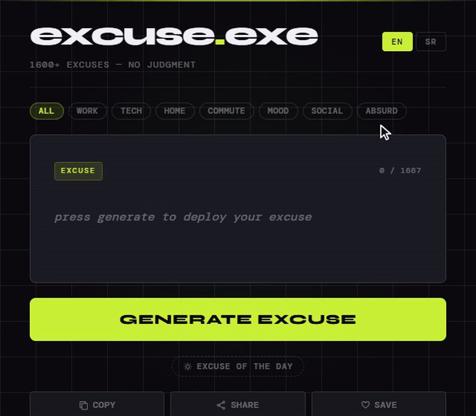
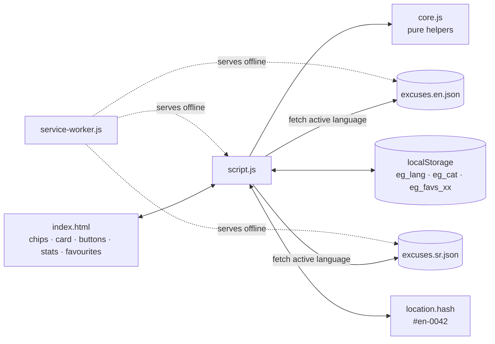
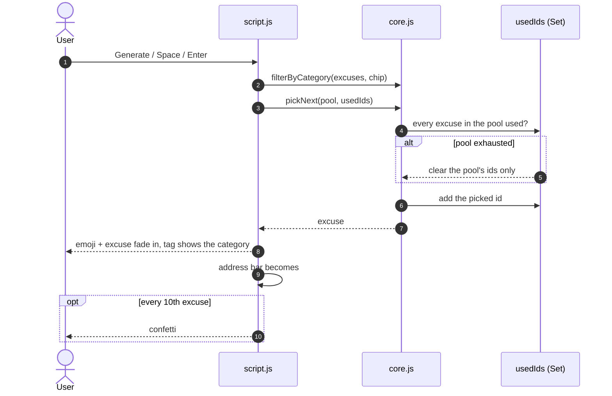
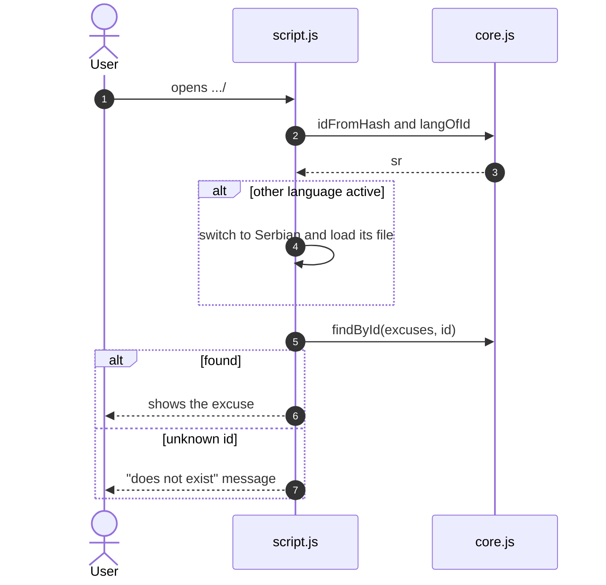

<div align="center">

# 🤷 excuse.exe

[](https://github.com/pero-grubac/excuse-generator/actions/workflows/ci.yml)
[](https://github.com/pero-grubac/excuse-generator/actions/workflows/deploy.yml)


**1,600+ excuses in English and 1,250+ in Serbian, sorted into seven categories, one tap away, never repeating until you have seen them all.**

[](https://pero-grubac.github.io/excuse-generator/)



</div>

---

## 📌 Project Overview

**excuse.exe** is a small, offline-capable PWA that hands you a random excuse at the press of a button (or the space bar). Pick a category or take them all, get one fixed excuse of the day, and share a link that opens exactly the excuse you are looking at. It goes through the whole list (or the whole category) before it repeats one, keeps your favourites per language, and copies or shares an excuse in one tap.

No framework, no build step, no runtime dependencies, and no external requests: the fonts are self-hosted.

---

## ✨ Features

- 🗂️ **Categories**: Work, Tech, Home, Commute, Mood, Social and Absurd, as filter chips; the choice is remembered
- 🎲 **No repeats** within the current filter until every excuse in it has been shown
- ☀️ **Excuse of the day**: one excuse per calendar day (local date) and language, the same for everyone
- 🔗 **Links to a single excuse**: every excuse has a stable id, the address bar shows `#en-0042`, and **Share** sends that link; opening it shows the excuse and switches language if needed
- 🌍 **English and Serbian**, switchable at any time; adding a language is one JSON file and one config block
- ⭐ **Favourites** per language, kept in `localStorage` by id (favourites saved by older versions as text are migrated automatically)
- 📋 **Copy and share**: clipboard copy of the text, or the native share sheet with the link (the link is copied where sharing is not supported)
- ⌨️ **Keyboard**: `Space` or `Enter` generates a new excuse
- 🎉 **Confetti** every 10th excuse
- 📱 **Installable PWA** that works fully offline after the first visit
- 🔤 **Self-hosted fonts** (Syne Variable, DM Mono as WOFF2), so nothing is loaded from a third party
- 🧪 **Tests**: data checks (ids, categories, blanks, duplicates, honest "N+" subtitle), unit tests for the pure logic, and Playwright smoke tests on desktop and mobile

---

## 🛠️ Tech Stack

| Technology | Usage |
|------------|-------|
| Vanilla JavaScript (ES2024, ES modules) | App logic, no framework |
| CSS custom properties | Design tokens, dark theme, responsive layout |
| Syne Variable + DM Mono | Display and UI fonts, self-hosted WOFF2 |
| Web App Manifest + Service Worker | Install support, offline cache |
| `localStorage` | Favourites, language and category |
| Clipboard / Web Share API | Copy and share |
| `node:test` | Data, logic and PWA integrity tests |
| Playwright | End-to-end smoke tests (desktop and mobile Chromium) |
| Lighthouse CI | Performance, accessibility, best-practice and SEO report |
| GitHub Actions + GitHub Pages | CI and deployment |

---

## 📁 Project Structure

```
excuse-generator/
├── index.html              App shell
├── style.css               Design tokens and all styles
├── script.js               Languages, UI, generator, favourites, deep links, copy/share
├── core.js                 Pure helpers: categories, ids, picking, excuse of the day, migration
├── service-worker.js       Offline cache (bypassed on localhost)
├── manifest.json           PWA manifest with the full icon set
├── excuses.en.json         English excuses
├── excuses.sr.json         Serbian excuses
├── favicon.ico
├── assets/
│   ├── fonts/              Syne Variable, DM Mono (WOFF2 + TTF sources)
│   └── icons/              16–512 px PNG icons and their SVG sources
├── tests/
│   ├── excuses.test.js     Excuse files: shape, ids, categories, blanks, duplicates, counts
│   ├── core.test.js        Id lookup, filtering, no-repeat picking, excuse of the day, migration
│   ├── pwa.test.js         Precached files, manifest icons, HTML ids and links
│   └── e2e/
│       ├── smoke.spec.js   Playwright smoke tests
│       └── server.mjs      Zero-dependency static server for the e2e run
├── playwright.config.js    Desktop + mobile projects, starts the static server
├── lighthouserc.json       Lighthouse CI settings
├── readme_assets/demo.gif
├── package.json            npm scripts; Playwright is the only (dev) dependency
├── LICENSE                 MIT
└── .github/workflows/
    ├── ci.yml              Unit tests, e2e tests and Lighthouse on pull requests and feature branches
    └── deploy.yml          Unit and e2e tests, then deploy to GitHub Pages
```

---

## 📦 Installation

You need [Git](https://git-scm.com/) and, for the tests and local server only, [Node.js](https://nodejs.org/) 20 or newer.

```bash
git clone https://github.com/pero-grubac/excuse-generator.git
cd excuse-generator
npm install            # only needed for the end-to-end tests
```

The app itself needs nothing installed.

---

## ▶️ Usage

### Run locally

```bash
npm start                      # http://localhost:8080
# or
python -m http.server 8080
```

The app is loaded as an ES module, so open it through a server rather than as a `file://` page. The Service Worker does no caching on `localhost` and `127.0.0.1`, so you always see your latest changes.

### In the app

| Action | How |
|--------|-----|
| New excuse | **Generate Excuse**, `Space` or `Enter` |
| Category | The chips under the title (**All**, **Work**, **Tech**, …) |
| Excuse of the day | **Excuse of the day** under the generate button |
| Save / unsave | **♡ Save** |
| Copy | **Copy** (the text) |
| Share | **Share** (system share sheet with the link; copies the link where sharing is not supported) |
| Language | **EN** / **SR** in the header |
| Favourites | **Saved Excuses** at the bottom; **Clear all** empties the list |

The counter in the card shows how far through the current filter you are (`12 / 538` for Tech).

### Links

Every excuse has an id: the language code and a number, e.g. `en-0042` or `sr-0007`. The address bar always shows the id of the excuse on screen, so

```
https://pero-grubac.github.io/excuse-generator/#sr-0007
```

opens that excuse, in Serbian, even if the visitor last used English. An unknown id shows a short "does not exist" message.

### Run the tests

```bash
npm test               # unit and data tests (node:test, no install needed)
npm run test:e2e       # Playwright smoke tests, desktop and mobile
```

`npm run test:e2e` starts a small static server on port 4321 by itself. To use a Chromium that is already installed instead of downloading one, set `PW_CHROMIUM_PATH=/path/to/chrome`; otherwise run `npx playwright install chromium` once.

---

## 🗃️ Data format

Each language is one JSON file with an array of excuses:

```json
[
  { "id": "en-0001", "text": "My alarm clock decided to take a personal day.", "cat": "home" },
  { "id": "en-0002", "text": "I was abducted by aliens and they dropped me off late.", "cat": "absurd" }
]
```

- **`id`**: `<language>-<4 digits>`, unique and stable. Links and favourites point to it, so never renumber existing excuses; new ones get the next free number.
- **`text`**: the excuse, trimmed, unique within the file.
- **`cat`**: one of the categories below.

| Category | What goes in it | EN | SR |
|----------|-----------------|---:|---:|
| `work` | Office, meetings, projects, business, finance and legal jargon | 722 | 377 |
| `tech` | Computers, phones, software and ops jargon | 538 | 348 |
| `home` | Bed, alarm, breakfast, household, pets, body | 131 | 215 |
| `commute` | Traffic, transport, weather and everything on the way | 72 | 107 |
| `mood` | Motivation, overthinking, procrastination, existential dread | 153 | 173 |
| `social` | Family, friends, neighbours and strangers | 19 | 38 |
| `absurd` | Aliens, curses, sentient objects and other nonsense | 32 | 33 |
| **Total** | | **1667** | **1291** |

The Serbian list is written in Latin script, in the ekavian variant.

---

## 🌍 Adding a language

1. Create `excuses.xx.json` in the format above, with ids `xx-0001`, `xx-0002`, …
2. Add an entry to `LANGUAGES` in `script.js` with `label`, `file` and the `ui` strings, including the `cats` labels (copy the `en` block and translate it).
3. Add `'excuses.xx.json'` to `SHELL` in `service-worker.js`.
4. Bump `CACHE` (e.g. `excuse-generator-v3` → `v4`).

`npm test` then checks the new file's ids, categories, blanks and duplicates, that every category has a label, and that the subtitle's "N+" is true.

---

## 🏗️ Architecture



### Generating an excuse



### Opening a link



**Excuse of the day** hashes `YYYY-MM-DD:language` (local date) with FNV-1a and takes that index modulo the list length, so it changes at local midnight and is the same on every device. Switching language loads the other file, resets the used set and the counter, and loads that language's favourites.

---

## 🚀 CI/CD

| Workflow | Runs on | What it does |
|----------|---------|--------------|
| `ci.yml` | Every push (including `main`) and pull request | Three jobs: **unit** (`npm test`), **e2e** (Playwright on desktop and mobile Chromium, traces uploaded on failure) and **lighthouse** (Lighthouse CI on exactly the files that get deployed, report uploaded as an artifact) |
| `deploy.yml` | After **CI passes on `main`**, or a manual run | Publishes the site's files to GitHub Pages; the tests already ran in CI |

Deploy is chained to CI (`workflow_run`): a push to `main` is tested once, and only a green run is published, from exactly the commit that was tested. Documentation-only commits start neither.

CI **skips documentation-only changes** (`*.md`, `readme_assets/`, `LICENSE`, `.gitignore`, `.vscode/`), and a newer run on the same branch cancels the older one.

Only the site's files are deployed (`index.html`, `style.css`, `script.js`, `core.js`, `service-worker.js`, `manifest.json`, `excuses.*.json`, `favicon.ico`, `assets/`).

**One-time setup:** **Settings → Pages → Build and deployment → Source** → **GitHub Actions**.

> **On every release** bump `CACHE` in `service-worker.js`. Files are served from the cache and refreshed in the background, so a new cache name makes sure returning visitors switch to the new files cleanly.

---

## 🧭 Design Decisions

- **Plain JSON per language.** Excuses are data, not code: easy to edit, easy to validate, loaded only for the active language.
- **Stable ids instead of positions.** Links and favourites survive edits, reordering and new excuses.
- **A small, fixed category set.** Seven categories, each assigned by hand, so the chips stay readable on a phone and every chip has enough behind it.
- **A set of used ids per filter** instead of shuffling the array: changing the category keeps what you have already seen, and nothing repeats until the category is exhausted.
- **Pure logic in `core.js`.** Picking, id lookup, the daily pick and the favourites migration have no DOM access, so they are unit-tested directly.
- **Network-first pages, cached files refreshed in the background, nothing cached on localhost.** Visitors get an instant offline app; development never fights a stale cache.
- **Self-hosted fonts** keep the app fully offline and avoid third-party requests.

---

## ⚠️ Known Limitations

- New excuses need a new deployment (and a `CACHE` bump).
- The Serbian set is smaller than the English one, and its jargon-heavy categories (work, tech) are a selection of the English ones rather than all of them.
- The excuse of the day follows the device's clock and time zone, so two people in different time zones can briefly see different ones.
- On desktop browsers without the Web Share API, **Share** copies the link instead.

---

## 📄 License

[MIT](LICENSE)

---

<div align="center">

*All excuses are fictional. Any resemblance to real situations is entirely intentional.*

</div>
